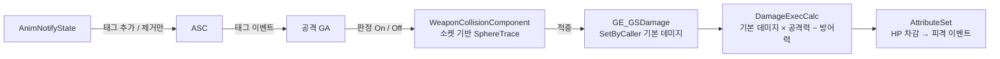

# GuitarSouls

**Unreal Engine 5.6 · C++ · Gameplay Ability System으로 만든 소울라이크 액션 RPG**

     

다크 소울 3의 튜토리얼 구간을 목표로 한 싱글플레이 소울라이크 버티컬 슬라이스입니다. 캡스톤 졸업 프로젝트로 진행했습니다.

컴포넌트 기반으로 게임을 먼저 작업한 다음 GAS 기반으로 다시 설계했습니다. 그리고 두 설계가 실제 코드와 작업 시간에서 어떻게 다른지 수치로 확인했습니다.

<!-- 플레이 영상 또는 GIF를 여기에 넣으세요:  -->
https://www.youtube.com/watch?v=5oC6rd8oAIc
<br>

## 한눈에 보기

| 항목 | 내용 |
| --- | --- |
| 장르 | 싱글플레이 3인칭 소울라이크 액션 RPG |
| 엔진 / 언어 | Unreal Engine 5.6, C++ (+ Blueprint 데이터) |
| 핵심 프레임워크 | Gameplay Ability System, Gameplay Tags, Behavior Tree |
| 기간 | 2025.07 – 2026.11 |
| 코드 규모 | `GuitarSoulsGAS` 모듈 C++ 약 1만 줄 (헤더 65개) |

<br>

## 플레이 흐름

```
타이틀 ─▶ 입구 (조작 튜토리얼 · 무기 획득) ─▶ 홀 (잡몹 전투) ─▶ 보스방 (2페이즈 보스) ─▶ 기록 입력 ─▶ 리더보드
```

- **입구** — 구간별 키 안내를 따라 이동, 무기 획득, 공격, 구르기를 익힙니다. 일부러 좁게 만들고 전투를 넣지 않았습니다.
- **홀** — 성향이 다른 적(신중형 / 공격형)과 연속으로 마주치며 전투에 적응합니다.
- **보스방** — HP 임계값에서 페이즈가 바뀌는 보스와 싸웁니다.
- **타임어택** — 타이틀에서 시작하면 경과 시간이 HUD에 표시되고 클리어하면 이니셜을 입력해 Top 10 리더보드에 기록됩니다.

<br>

## 왜 GAS로 다시 만들었나

컴포넌트 기반 설계에서는 캐릭터와 상태가 늘어날수록 클래스끼리 서로를 직접 참조하는 일이 많아집니다. 실제로 1학기 코드에서는 플레이어 클래스 하나에 전체 분기 복잡도의 24%가 몰려 있었고 공격 가능 여부 같은 상태 판정이 하드코딩된 목록과 `SetState` 호출로 흩어져 있었습니다. 기획 수치 하나를 바꾸려 해도 C++을 고치고 다시 컴파일해야 했습니다.

GAS로 다시 설계하면서 세 가지를 나눴습니다.

| 계층 | 담당 | 예시 |
| --- | --- | --- |
| 데이터 | Attribute, Gameplay Effect | HP · 스태미너 · 공격력, 데미지 · 회복 · 버프 |
| 로직 | Gameplay Ability | 공격, 구르기, 락온, 포션, 상호작용 |
| 표현 | Montage, Widget | 공격 모션, 피격 리액션, HUD |

상태는 계층형 Gameplay Tag로 표현하고 어떤 행동이 언제 막히는지는 각 Ability의 차단 태그로 Blueprint에서 정합니다.

<br>

## 성과

컴포넌트 모델과 GAS 모델을 같은 기능 범위에서 비교했습니다.

| 비교 항목 | 컴포넌트 모델 | GAS 모델 |
| --- | --- | --- |
| 스택형 버프 1개 추가 | C++ 233줄, 기존 코드 3곳 수정 | C++ 0줄, Blueprint 에셋 1개 |
| 두 번째 버프(가드) 추가 | — | 에셋 제작 58초, C++ 0줄 |
| 하드코딩된 상태 판정 목록 | 24줄, `SetState` 호출 11곳 | 0줄, 0곳 |
| 복잡도가 가장 높은 파일의 비중 | 24.1% (플레이어 클래스) | 7.7% |
| "피격 중 구르기 허용" 같은 규칙 변경 | C++ 수정 + 재컴파일 | 차단 태그 1개 제거, 재컴파일 없음 |

- 버프의 기반 구조(데미지 계산 `ExecCalc`, 공격력 · 방어력 어트리뷰트)는 C++ 167줄로 한 번만 만들었고 그 뒤의 버프는 데이터로만 추가했습니다.
- 복잡도는 [lizard](https://github.com/terryyin/lizard)로 측정한 순환 복잡도(CCN)이며 null 검사 같은 방어 분기를 뺀 보정값입니다. GAS 모델은 기능이 더 많아 코드 총량이 약 1.67배입니다. 그래서 총량이 아니라 **복잡도가 어디에 몰려 있는지**를 비교했습니다.
- 캡스톤 전시에서는 같은 버프를 두 방식으로 구현해 두고 게임 안에서 실시간으로 바꿔 가며 차이를 보여 줬습니다.

<br>

## 아키텍처

### 모듈 구조

```
Source/GuitarSoulsGAS/
├── Character/     캐릭터 계층 (Base / Player / Enemy / Boss)
├── GA/            Gameplay Ability (공격, 구르기, 락온, 포션, 상호작용, 보스 페이즈 …)
├── GE/            Gameplay Effect (데미지, 회복, 스태미너 비용, 초기 스탯)
├── Attribute/     AttributeSet (HP, 스태미너, 포션, 공격력, 방어력)
├── Calculation/   데미지 ExecCalc
├── AI/            AIController, BTTask / BTService / BTDecorator
├── Animation/     AnimInstance, AnimNotify(State)
├── Component/     무기 충돌, 타게팅, 광폭화(비교용 컴포넌트 구현)
├── Item/ Data/    무기 액터, 무기 DataAsset
├── Gimmick/       레벨 전환 볼륨
├── Save/          체크포인트 저장, 런 타이머, 리더보드
├── Interactable/ Interface/
├── Tags/          Native Gameplay Tags
└── UI/            HUD, 보스 HP 바, 타이틀, 승리 / 게임오버
```

### 캐릭터 계층

```
ACharacter
└── AGSGASCharacterBase          ASC 캐시, 무기 장착, 시작 Ability 부여
    ├── AGSGASCharacterPlayer    ASC는 PlayerState 소유, 레벨 이동 시 상태 저장 · 복원
    └── AGSGASCharacterEnemy     ASC 직접 보유, 순찰 · 경보
        └── AGSGASCharacterBoss  페이즈 전환
```

플레이어의 ASC를 PlayerState에 두어 캐릭터가 죽고 다시 생성돼도 능력과 스탯을 유지합니다. 적은 캐릭터가 ASC를 직접 가집니다.

### 공격 판정 흐름



애니메이션 노티파이는 판정을 직접 하지 않고 태그만 붙였다 뗍니다. 판정을 켜고 끄는 결정은 Ability가 내리기 때문에 애니메이션 에셋과 전투 로직이 서로를 몰라도 됩니다.

<br>

## 핵심 시스템

### 전투

- **약공 · 강공 콤보** — 공격 종류마다 몽타주 하나를 두고 섹션으로 나눴습니다. `ComboWindow` 태그가 붙어 있는 구간에 입력이 들어오면 다음 섹션으로 넘어갑니다.
- **4방향 피격 리액션** — 공격자와 피격자의 상대 각도로 앞 · 뒤 · 좌 · 우 리액션을 고릅니다.
- **스태미너 · 포션 · 락온 · 구르기** — 모두 독립된 Ability이고 스태미너 · 포션 소모는 Gameplay Effect로 처리합니다.

### 적 · 보스 AI

- **행동 선택** — Blackboard 플래그 대신 Gameplay Tag(`AI.Behavior.*`)와 어트리뷰트 값을 읽는 BTService · BTDecorator로 판단합니다.
- **공격 실행** — BT 태스크가 `SendGameplayEventToActor`로 공격 Ability를 발동합니다. AI도 플레이어와 같은 Ability 경로를 씁니다.
- **보스 패턴** — Shuffle Bag 방식으로 모든 패턴이 한 번씩 나온 뒤에 다시 섞습니다. 같은 패턴만 반복되지 않습니다.
- **페이즈 전환** — HP가 임계값에 닿으면 AttributeSet이 태그를 붙이고 페이즈 전환 Ability가 한 번 발동합니다. 전환 중에는 면역 태그로 데미지를 받지 않습니다.

### 레벨 전환과 체크포인트

- 플레이어가 전환 볼륨에 닿으면 `OpenLevel`로 다음 맵을 엽니다.
- 레벨이 바뀌면 PlayerState와 캐릭터가 모두 사라지므로, `GameInstanceSubsystem`에 HP · 스태미너 · 포션 · 장착 무기를 저장했다가 새 맵에서 복원합니다.
- 버프로 오른 공격력이 영구 스탯으로 굳지 않도록 현재값과 기본값을 나눠 저장합니다.
- 저장 데이터는 체크포인트로 남겨 두어, 죽고 다시 시작해도 무기를 잃지 않습니다.

### 타이틀 · 타임어택 리더보드

- 벽시계 기준 런 타이머를 `GameInstanceSubsystem`으로 두어 레벨을 넘어가도 시간이 이어집니다. 죽어도 시계는 멈추지 않습니다.
- 기록은 `USaveGame`으로 Top 10까지 로컬에 저장합니다.

<br>

## 설계 원칙

| 원칙 | 내용 |
| --- | --- |
| C++ / Blueprint 경계 | 런타임 로직은 C++, 수치와 Ability 활성화 · 차단 태그는 Blueprint 기본값 |
| 노티파이는 태그만 | AnimNotify는 ASC 태그를 붙이고 떼는 일만 하고, 판정 로직은 Ability에 둠 |
| 데이터 주도 | 무기 · 데미지 · 공격 패턴은 DataAsset과 SetByCaller로 구성 |
| 로그 통일 | 모듈 전체에서 `GSGAS_LOG` 매크로 사용 |

<br>
